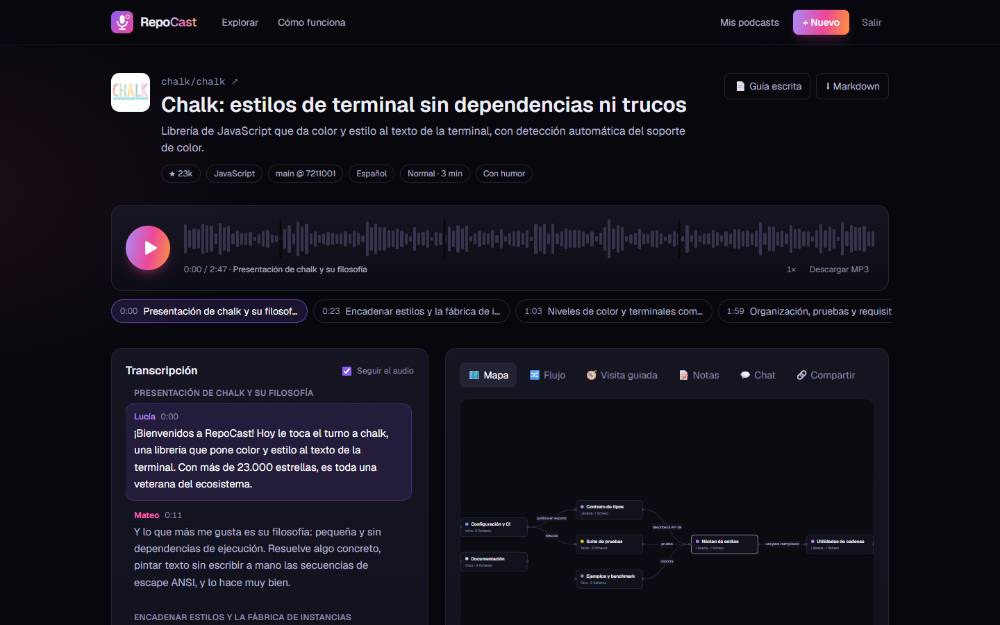
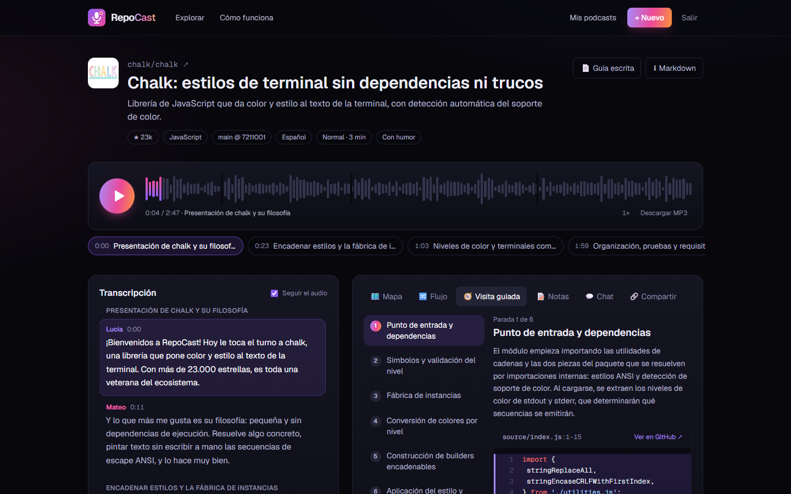
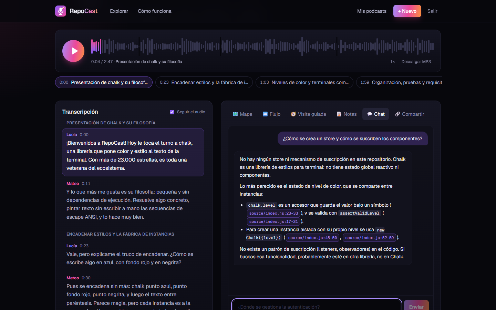
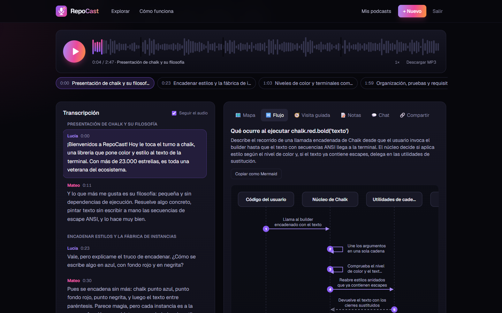
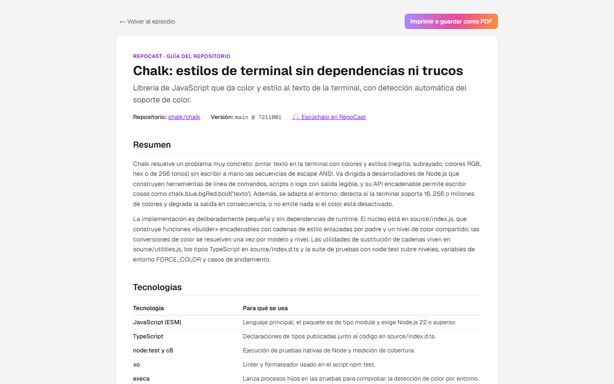
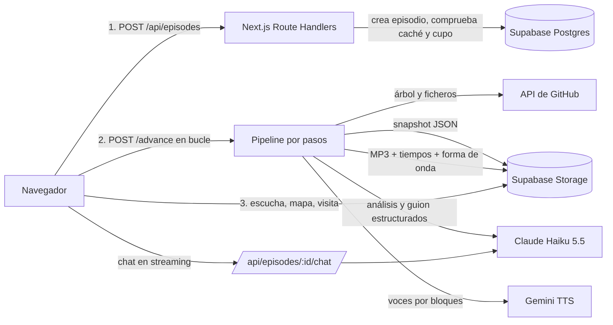

# 🎙️ RepoCast

**Escucha cualquier repositorio de GitHub como si fuera un podcast.**

RepoCast lee el código de un repositorio público y lo convierte en un **programa de radio de dos voces**, un **mapa interactivo de su arquitectura**, una **visita guiada por el código** y un **chat** que responde citando ficheros y líneas.

> Trabajo Fin de Máster · Máster de Desarrollo con IA (BIG school)

| Recurso | Enlace |
|---|---|
| 🌐 Aplicación desplegada | _TODO: URL de Vercel_ |
| 💻 Repositorio | [github.com/Dv3git/RepoCast](https://github.com/Dv3git/RepoCast) |
| 📊 Presentación | [docs/RepoCast-presentacion.pptx](docs/RepoCast-presentacion.pptx) |
| 🎬 Vídeo explicativo | _TODO: URL de YouTube o Drive_ · [guion](docs/guion-video.md) |
| 👤 Usuario de prueba | `demo@repocast.app` · contraseña `RepoCast-demo-2026` |

En la pantalla de entrar hay un botón **"Probar con la cuenta demo"** que la rellena sola.



<table>
  <tr>
    <td></td>
    <td></td>
  </tr>
  <tr>
    <td align="center">Visita guiada</td>
    <td align="center">Chat con citas</td>
  </tr>
  <tr>
    <td></td>
    <td></td>
  </tr>
  <tr>
    <td align="center">Flujo principal y capítulos</td>
    <td align="center">Guía escrita (PDF y Markdown)</td>
  </tr>
</table>

---

## Índice

1. [Descripción general](#1-descripción-general)
2. [Funcionalidades principales](#2-funcionalidades-principales)
3. [Stack tecnológico](#3-stack-tecnológico)
4. [Arquitectura](#4-arquitectura)
5. [Instalación y ejecución](#5-instalación-y-ejecución)
6. [Estructura del proyecto](#6-estructura-del-proyecto)
7. [Despliegue](#7-despliegue)
8. [Costes, límites y seguridad](#8-costes-límites-y-seguridad)
9. [Tests y calidad](#9-tests-y-calidad)
10. [Uso de IA en el proyecto](#10-uso-de-ia-en-el-proyecto)
11. [Próximos pasos](#11-próximos-pasos)

---

## 1. Descripción general

Llegar a un proyecto que no conoces cuesta: hay que encontrar el punto de entrada, entender cómo se reparten las responsabilidades y saber qué ficheros merece la pena leer primero. RepoCast lo hace por ti y te lo cuenta **como lo contaría un compañero que ya se ha leído el código**.

Pegas la URL de un repositorio público, eliges idioma (español o inglés), duración (1, 3 o 6 minutos) y estilo (divulgativo, técnico o con humor). En uno o dos minutos tienes:

- un **podcast** donde Lucía pregunta lo que preguntaría cualquiera y Mateo, el experto, lo explica;
- la **transcripción sincronizada** con el audio, que te lleva al fichero del que se está hablando;
- un **mapa de la arquitectura** con los módulos reales del proyecto y cómo se relacionan;
- una **visita guiada** de 5-7 paradas por el código, con las líneas importantes resaltadas;
- un **chat** con el repositorio que cita ficheros y líneas que puedes abrir con un clic;
- un **diagrama de secuencia** del recorrido principal del código y un **glosario** con los conceptos clave;
- **capítulos**, **enlaces a un momento concreto** del audio y **notas privadas** mientras escuchas;
- una **guía escrita** para imprimir, guardar en PDF o descargar en Markdown.

También puede hacer un **podcast de novedades**: eliges dos versiones (tags, ramas o commits) y te cuenta qué ha cambiado entre ellas, como un parte de noticias.

**Para quién es:**
- Programadores que se incorporan a un proyecto.
- Quien evalúa una librería antes de usarla.
- Mantenedores que quieren explicar su proyecto o sus releases con un enlace o una insignia en el README.
- Cualquiera que aprende escuchando: en el coche, en el gimnasio…

---

## 2. Funcionalidades principales

| Funcionalidad | Detalle |
|---|---|
| 🎙️ **Podcast de dos voces** | Guion escrito por Claude y voces de Gemini TTS, con un diálogo natural entre dos presentadores. Elige el idioma (ES/EN), la duración (1/3/6 min) y el estilo (divulgativo, técnico o humor). |
| 📝 **Transcripción sincronizada** | La frase que suena se resalta y la vista la sigue. Pulsa una frase para saltar a ese momento o un fichero para abrirlo. |
| 🗺️ **Mapa de arquitectura** | Diagrama interactivo (React Flow + dagre) con los módulos, su tipo y sus relaciones. Los módulos de los que se está hablando se iluminan mientras suena el audio. |
| 🧭 **Visita guiada** | Recorrido ordenado como lo haría un veterano: del punto de entrada al flujo principal, con el código resaltado por Shiki. |
| 💬 **Chat con el repositorio** | Claude responde con el contexto del repositorio en caché y cita `ruta:líneas`. Las citas se abren en un panel lateral. |
| 📑 **Capítulos y enlaces a un momento** | Claude divide el episodio en capítulos que aparecen sobre la forma de onda, en la transcripción y junto al tiempo. Cualquier momento se comparte con `?t=95` (o `1:35`), también en el reproductor incrustado. |
| 🔀 **Flujo principal** | Diagrama de secuencia propio en SVG del recorrido más importante del código (por ejemplo, "qué pasa al llamar a `create()`"). Cada paso abre su código, los participantes se iluminan cuando el audio habla de su módulo y se puede copiar como Mermaid. |
| 📒 **Notas y marcadores** | Notas privadas en un segundo del audio, o marcadores de un clic. Salen como puntos sobre la forma de onda y se guardan en la cuenta. |
| 📄 **Guía escrita** | El episodio convertido en documento: resumen, stack, módulos, flujo con Mermaid, visita guiada con el código, glosario, capítulos, tus notas y la transcripción. Se imprime o guarda como PDF y se descarga en Markdown. |
| 📰 **Podcast de novedades** | Compara dos versiones con la API de GitHub. Agrupa los cambios por significado (novedad, arreglo, rompe compatibilidad…) y enseña los diffs. |
| 🔗 **Compartir y embeber** | Página pública por episodio, reproductor para incrustar con `<iframe>`, insignia SVG para el README, descarga en MP3 y enlaces para redes. |
| 🔐 **Cuentas** | Registro con email y contraseña, sin confirmación para entrar al momento. Cupo diario por usuario. |
| ♻️ **Caché inteligente** | Si alguien pide un repositorio, commit y ajustes ya generados, recibe el episodio existente sin gastar. El análisis se reutiliza entre estilos y duraciones del mismo commit. |

---

## 3. Stack tecnológico

| Capa | Tecnología | Por qué |
|---|---|---|
| Framework | **Next.js 16.4** (App Router, Cache Components, Partial Prerendering) + **React 19** | Frontend y backend en un solo proyecto. Las páginas sirven al instante un esqueleto estático y los datos llegan en streaming. |
| Lenguaje | **TypeScript** (estricto) | Tipos compartidos entre servidor y cliente. |
| Estilos | **Tailwind CSS 4** | Diseño propio, oscuro, accesible y adaptado al móvil. |
| IA: análisis y guion | **Claude Haiku 5.5** (`@anthropic-ai/sdk`), configurable | Rápido y muy barato (~0,01 $ por repositorio) con calidad de sobra para esta tarea. Con `CLAUDE_MODEL` se cambia a Sonnet u Opus sin tocar código. Usa salidas estructuradas validadas con Zod, caché de prompts en el chat y control de la longitud del guion. |
| IA: voces | **Gemini 3.8 Flash TTS** (API Interactions) | Diálogo a dos voces nativo y dirección de estilo por intervención. Si se agota el cupo, pasa solo a Flash Lite. |
| Base de datos y usuarios | **Supabase** (Postgres + Auth + Storage) | Usuarios con email y contraseña, tablas con RLS y almacenamiento de MP3 y snapshots. |
| Datos de repositorios | **API de GitHub** (REST) | Árbol, ficheros, ramas y tags, y comparación entre versiones. |
| Visualización | **React Flow** + **dagre** · **Shiki** | Mapa interactivo con disposición automática · resaltado de código igual que en VS Code. |
| Audio | Codificador **lamejs** (MP3) | El WAV de Gemini se pasa a MP3 de 64 kbps: unas 6 veces menos peso. |
| Tests | **Vitest** + **Playwright** | Tests unitarios de la lógica pura y prueba E2E en un navegador real que además genera las capturas. |
| Despliegue | **Vercel** | Funciones serverless con `maxDuration` de 300 s para los pasos largos. |

---

## 4. Arquitectura



### El pipeline

Generar un episodio lleva alrededor de un minuto y medio (en la última prueba E2E con chalk, 82 s, con capítulos, flujo y glosario incluidos). En lugar de un proceso en segundo plano, **cada llamada a `POST /api/episodes/:id/advance` ejecuta un solo paso y termina**. El navegador va pidiendo el siguiente mientras muestra el progreso.

| Paso | Qué hace | Tiempo típico |
|---|---|---|
| `ingesting` | Pide el árbol a GitHub. Puntúa cada fichero (README, manifiestos, puntos de entrada, `src/`; penaliza tests, ejemplos y ficheros enormes) y descarga los mejores hasta un presupuesto de unos 170.000 caracteres. Guarda el snapshot en Storage. | 3-5 s |
| `analyzing` | Claude devuelve un JSON validado con Zod: título, resumen, stack, módulos, relaciones, visita guiada y curiosidades. Después se limpian rutas inventadas, relaciones rotas y líneas fuera de rango. | 15-25 s |
| `scripting` | Claude escribe el diálogo con la duración, el estilo y el idioma pedidos, y marca qué ficheros menciona cada intervención. Si el guion se desvía más de un 20 % de las palabras objetivo, se pide otra versión y se queda la más ajustada. **En paralelo** prepara el diagrama de flujo y el glosario del análisis y, al terminar el guion, lo divide en capítulos. Estos extras son opcionales: si fallan, el episodio sigue y se generan la primera vez que alguien los pide. | 15-35 s |
| `voicing` | El guion se divide en bloques de unas 130 palabras, que Gemini locuta (3 en paralelo). Los WAV se unen, se calculan los tiempos de cada intervención y la forma de onda, y se codifica a MP3. | 15-30 s |

Ventajas de este diseño:
- **Cada paso cabe holgado** en el límite de tiempo de una función serverless.
- **Si falla un paso, solo se reintenta ese**, hasta 3 veces. Si el error es definitivo, el autor puede pulsar "Reintentar" y continúa desde el último paso completado.
- **Un bloqueo optimista** (`locked_until`) impide que dos pestañas ejecuten el mismo paso a la vez.

### Modelo de datos

- `analyses`: el análisis de Claude por repositorio, commit e idioma, y sus extras (diagrama de flujo y glosario). Se reutiliza entre episodios.
- `episodes`: cada podcast con sus ajustes, estado, guion con tiempos, capítulos, ruta del MP3 y forma de onda.
- `notes`: notas y marcadores de cada usuario en un segundo de un episodio. Son privadas.
- `usage_events`: registro para los cupos diarios.
- Buckets de Storage: `podcasts` (público, MP3) y `snapshots` (privado, código descargado).

Esquema completo en [supabase/migrations/001_schema.sql](supabase/migrations/001_schema.sql). Los permisos están en [002_grants.sql](supabase/migrations/002_grants.sql): los proyectos nuevos de Supabase ya no conceden acceso automático a las tablas creadas por SQL, así que se da solo al rol del servidor (`service_role`). [003_extras_notes.sql](supabase/migrations/003_extras_notes.sql) añade capítulos, extras y notas.

---

## 5. Instalación y ejecución

### Requisitos
- Node.js 20 o superior y npm.
- Cuentas (todas con capa gratuita o de prepago):
  - [Claude Platform](https://platform.claude.com): clave de API con algo de crédito.
  - [Google AI Studio](https://aistudio.google.com/apikey): clave de Gemini.
  - [GitHub](https://github.com/settings/personal-access-tokens): token fine-grained de solo lectura de repositorios públicos.
  - [Supabase](https://supabase.com): un proyecto. En *Authentication → Sign In / Providers → Email*, desactiva *Confirm email*.

### Pasos

```bash
git clone https://github.com/Dv3git/RepoCast.git repocast
cd repocast
npm install

# 1. Variables de entorno
cp .env.example .env.local      # y rellénalo (ver tabla)
npm run check-keys              # comprueba que cada clave funciona, sin mostrarlas

# 2. Base de datos: tablas, funciones y buckets
npm run db:migrate
npm run db:seed                 # crea la cuenta demo

# 3. Arrancar
npm run dev                     # http://localhost:3000
```

| Variable | Para qué |
|---|---|
| `ANTHROPIC_API_KEY` | Claude: análisis, guion y chat |
| `CLAUDE_MODEL` | Opcional. Por defecto `claude-haiku-5-5`; también `claude-sonnet-5-5` o `claude-opus-5-5` |
| `GEMINI_API_KEY` | Voces del podcast |
| `GITHUB_TOKEN` | Leer repositorios (5.000 peticiones/hora en vez de 60) |
| `NEXT_PUBLIC_SUPABASE_URL` / `NEXT_PUBLIC_SUPABASE_PUBLISHABLE_KEY` | Sesión del usuario |
| `SUPABASE_SECRET_KEY` | Acceso del servidor a la base de datos y Storage |
| `SUPABASE_DB_URL` | Solo para `npm run db:migrate` (cadena *Session pooler*) |
| `NEXT_PUBLIC_SITE_URL` | URL pública. Se usa en los metadatos y Open Graph |
| `LIMIT_EPISODES_PER_DAY`, `LIMIT_CHAT_PER_DAY`, `LIMIT_EPISODES_GLOBAL_PER_DAY` | Opcionales. Cupos (por defecto 3, 30 y 60) |

### Scripts

| Comando | Qué hace |
|---|---|
| `npm run dev` / `build` / `start` | Desarrollo, compilación y servidor de producción |
| `npm test` | Tests con Vitest |
| `npm run typecheck` / `lint` | TypeScript y ESLint |
| `npm run check-keys` | Verifica las claves de `.env.local` |
| `npm run db:migrate` / `db:seed` | Crea el esquema y la cuenta demo |
| `npm run e2e` | Prueba E2E en Chrome (con la app arrancada) y capturas en `docs/screenshots/` |
| `npm run gallery` | Genera los episodios de ejemplo de la galería con la cuenta demo |
| `npm run backfill` | Añade capítulos, diagrama de flujo y glosario a episodios generados antes de que existieran |

---

## 6. Estructura del proyecto

```
├── src/
│   ├── app/
│   │   ├── (site)/                  # Páginas con cabecera y pie
│   │   │   ├── page.tsx             # Portada + galería
│   │   │   ├── nuevo/               # Formulario para crear un podcast
│   │   │   ├── e/[slug]/            # Página del episodio
│   │   │   ├── explorar/            # Todos los episodios
│   │   │   ├── mis-podcasts/        # Episodios del usuario y cupos
│   │   │   └── (auth)/              # Entrar, registro y server actions
│   │   ├── (print)/e/[slug]/guia/   # Guía escrita imprimible (sin cabecera)
│   │   ├── embed/[slug]/            # Reproductor para <iframe>
│   │   ├── api/
│   │   │   ├── episodes/            # Crear, estado, avanzar, reintentar, chat, ficheros, reproducciones,
│   │   │   │                        # extras (flujo y glosario), notas y guía en Markdown
│   │   │   ├── github/refs/         # Ramas y tags para el podcast de novedades
│   │   │   └── badge/[slug]/        # Insignia SVG
│   │   └── auth/salir/              # Cerrar sesión
│   ├── components/
│   │   └── episode/                 # Reproductor, transcripción, mapa, visita, chat, compartir…
│   ├── lib/
│   │   ├── pipeline.ts              # Máquina de estados del episodio (un paso por llamada)
│   │   ├── claude.ts                # Prompts, esquemas Zod, análisis, guion, capítulos, extras y chat
│   │   ├── extras.ts / flow.ts      # Diagrama de flujo y glosario: generación, limpieza y Mermaid
│   │   ├── chapters.ts              # Capítulos y enlaces ?t= a un momento del audio
│   │   ├── guide.ts / guide-data.ts # Guía escrita en Markdown y los datos que necesita
│   │   ├── notes.ts                 # Notas y marcadores del usuario
│   │   ├── tts.ts / audio.ts        # Gemini TTS, WAV, MP3, tiempos y forma de onda
│   │   ├── github.ts / snapshot.ts  # Lectura del repositorio y snapshot para Claude
│   │   ├── select-files.ts          # Qué ficheros leer (puntuación + presupuesto)
│   │   ├── episodes.ts / quota.ts   # Datos, caché de episodios y cupos diarios
│   │   └── supabase/server.ts       # Clientes de Supabase (sesión y servidor)
│   └── proxy.ts                     # Refresca la sesión en cada navegación
├── supabase/migrations/             # Esquema SQL
├── scripts/                         # Migración, cuenta demo, comprobación de claves, pruebas de humo
├── tests/                           # Tests de Vitest
└── docs/                            # Presentación, guion del vídeo y capturas
```

---

## 7. Despliegue

La app está pensada para **Vercel**:

1. Importa el repositorio de GitHub en Vercel. Detecta Next.js solo.
2. Añade las variables de entorno de la tabla anterior, salvo `SUPABASE_DB_URL`, que no hace falta en producción. Pon `NEXT_PUBLIC_SITE_URL` con la URL final.
3. Despliega.

Las rutas del pipeline declaran `maxDuration = 300`, compatible con el plan gratuito de Vercel con Fluid Compute. Las tablas y la cuenta demo se crean una sola vez desde local con `npm run db:migrate` y `npm run db:seed`.

**URL de producción:** _TODO_

---

## 8. Costes, límites y seguridad

### Coste por episodio (aproximado)

| Paso | Consumo típico | Coste |
|---|---|---|
| Análisis (Claude Haiku 5.5) | ~85.000 tokens de entrada y ~3.000 de salida | ~0,01 $ |
| Guion y capítulos (Claude Haiku 5.5) | ~6.000 de entrada y ~2.500 de salida | < 0,01 $ |
| Flujo y glosario (Claude Haiku 5.5) | ~90.000 de entrada y ~2.000 de salida, una vez por análisis | ~0,01 $ |
| Voces (Gemini 3.8 Flash TTS) | ~25 tokens de audio por segundo (3 min ≈ 4.500) | ~0,04 $ |

- Pedir **otro estilo o duración del mismo commit** reutiliza el análisis y cuesta unos 0,04 $.
- **Repetir un episodio ya existente** cuesta 0.
- **En el chat**, el contexto del repositorio va en la caché de prompts de Claude: la primera pregunta paga el contexto y las siguientes lo leen de caché a una décima parte del precio.
- Con `CLAUDE_MODEL` se puede subir la calidad del análisis: Sonnet 5.5 (~0,22 $ por repositorio) u Opus 5.5 (~0,45 $).

### Límites para proteger el saldo
- **3 podcasts nuevos al día por usuario**, **30 preguntas al chat** y **60 podcasts nuevos al día en total**. Configurable por variables de entorno.
- Gemini usa dos modelos de voz con cupos independientes y cambia de uno a otro si uno se agota.
- Los proveedores tienen topes de gasto: prepago en Claude y límite de inversión en Google Cloud.

### Seguridad
- **Las claves solo existen en el servidor**. El navegador nunca ve la de Claude, la de Gemini, la de GitHub ni la secreta de Supabase.
- **RLS activado en todas las tablas sin políticas públicas**: solo el servidor, con la clave secreta, puede leer o escribir. Las rutas comprueban la sesión (`getClaims`) en cada operación que gasta dinero.
- **Inyección de prompts**: el código del repositorio se trata como datos no fiables. El prompt de sistema prohíbe seguir instrucciones que aparezcan en él.
- **Validación de entradas** con Zod en todas las rutas.
- Las redirecciones tras el login solo aceptan rutas internas.
- El HTML de Shiki se genera en el servidor a partir de texto escapado. El markdown del chat se convierte en componentes de React, nunca en HTML.
- **Cabeceras de seguridad**: `X-Frame-Options`/`frame-ancestors` (salvo en `/embed`), `nosniff`, `Referrer-Policy`, `Permissions-Policy` y HSTS.
- Solo se analizan **repositorios públicos**.

---

## 9. Tests y calidad

```bash
npm test          # 61 tests de Vitest
npm run typecheck # TypeScript estricto
npm run lint      # ESLint (reglas de Next.js y React Hooks)
npm run e2e       # Prueba E2E en Chrome contra http://localhost:3000
```

Qué cubren los tests:
- **Selección de ficheros:** qué se ignora, la puntuación y que se respete el presupuesto.
- **Audio:** lectura de WAV, unión con silencios, división en bloques, reparto de tiempos, forma de onda y que el MP3 sea válido.
- **URLs de GitHub:** todas las variantes que puede pegar un usuario y las entradas maliciosas.
- **Markdown del chat:** citas, bloques de código y que el HTML no se interprete.
- **Cupos:** medianoche de Madrid en horario de invierno y de verano.
- **Capítulos y enlaces:** limpieza de lo que devuelve Claude, capítulo activo y todas las formas de `?t=` (`95`, `1:35`, `1m35s`).
- **Diagrama de flujo:** participantes repetidos o sin uso, pasos rotos, rutas inventadas, ids válidos y Mermaid sin caracteres que lo rompan.
- **Guía escrita:** secciones, enlaces a GitHub en el commit exacto, tablas escapadas, notas ordenadas y versión en inglés.

La **prueba E2E** ([scripts/e2e.mts](scripts/e2e.mts)) usa Playwright con el Chrome instalado y recorre la app como un usuario:
1. Registro de una cuenta nueva y cierre de sesión.
2. Login con la cuenta demo.
3. Creación de un podcast y espera a que se genere.
4. Reproducción, visita guiada, pregunta al chat y pestaña de compartir.
5. Capítulos, diagrama de flujo, una nota guardada, descarga de la guía en Markdown (con la nota) y guía imprimible.
6. Página pública sin sesión, reproductor embebido e insignia.
7. Mis podcasts, explorar y vista móvil.

Por el camino guarda las capturas de [docs/screenshots/](docs/screenshots/).

Además hay dos **pruebas de humo** contra las APIs reales: `scripts/smoke-pipeline.mts` (GitHub → Claude → Gemini) y `scripts/smoke-tts.mts` (solo voces).

---

## 10. Uso de IA en el proyecto

**Dentro del producto:**
- **Claude Haiku 5.5** analiza la arquitectura, escribe el guion, lo divide en capítulos, dibuja el flujo principal, redacta el glosario y responde en el chat. Usa salidas estructuradas (JSON Schema a partir de Zod), *effort* adaptado a cada tarea (medio para análisis y guion, bajo para el chat) y caché de prompts. Con Sonnet u Opus añade además fallback automático en el servidor.
- **Gemini 3.8 Flash TTS** pone las dos voces, con dirección de estilo por intervención (tono, acento de España…).
- La IA nunca trabaja a ciegas: la app **elige qué leer**, **valida y limpia** lo que devuelve el modelo (rutas que existen, líneas en rango, relaciones entre módulos reales, diagramas con participantes y pasos coherentes) y **mide** el consumo de cada paso.

**En el desarrollo:**
- El proyecto se ha desarrollado con **Claude Code** como asistente. Se usó para generar ideas, diseñar la arquitectura, escribir y revisar código, leer la documentación de Next.js 16, preparar los tests y documentar.
- Las decisiones de producto y alcance fueron del autor: qué funcionalidades incluir, el tono del podcast, los límites de gasto y los proveedores. Todo se ha verificado con tests, compilación de producción y pruebas reales contra las APIs.

---

## 11. Próximos pasos

- Repositorios privados con login de GitHub (OAuth).
- Feed RSS para suscribirse a los episodios de un repositorio, por ejemplo uno por release.
- Elegir las voces de los presentadores.
- Análisis por fragmentos para monorepos enormes.
- Métricas de calidad del guion con evaluaciones automáticas.

---

**Autor:** _TODO: nombre completo_ · Máster de Desarrollo con IA · 2026
